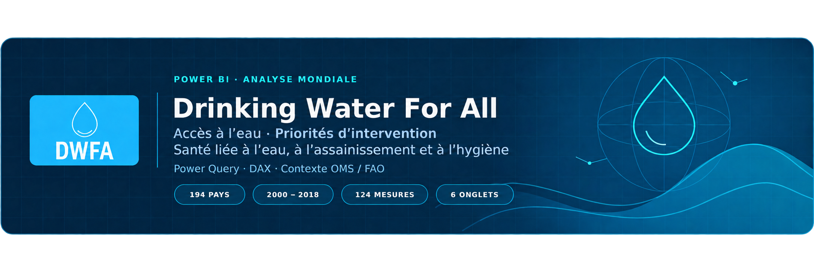

# Drinking Water For All • Power BI

🌐 [Read this README in English](README.md)

Un projet d’analyse de l’accès à l’eau potable pour **Drinking Water For All (DWFA)**, réalisé dans le cadre du parcours **Data Analyst d’OpenClassrooms**. Le rapport croise les niveaux de service, la démographie, la santé liée à l’eau, à l’assainissement et à l’hygiène, et la stabilité politique pour explorer les besoins de création et de modernisation des services d’eau.

Le sigle anglais **WASH** (*Water, Sanitation and Hygiene*) désigne **l’eau, l’assainissement et l’hygiène**. Il est utilisé dans la documentation pour les indicateurs de santé associés à ces trois domaines.

Le périmètre de référence couvre **194 pays**, sur **19 années, de 2000 à 2018**. Des compléments **OMS / FAO** enrichissent l’analyse avec l’assainissement, l’hygiène et la superficie terrestre.

**Power BI Desktop • Power Query / M • DAX • PBIP • Python en complément**

L’interface du rapport et les guides détaillés Power Query et DAX sont en **français**. Les noms techniques des tables, colonnes et mesures sont conservés dans les deux versions de la documentation.

## Documentation du projet

| Guide | Contenu |
|---|---|
| [Power Query • Préparer les données](power-query/README.md) — français | Sources, paramètres, 25 requêtes, chargement des tables et relations |
| [DAX • Construire les indicateurs](dax/README.md) — français | 10 fichiers dans l’ordre de création, 124 mesures, formats, dossiers et construction des 6 onglets |
| [Power BI • Ouvrir et versionner le projet](power-bi/README.md) — anglais | Projet PBIP, modèle initial, thème sombre et fichiers à suivre dans Git |

Le dépôt est enrichi progressivement : **préparation des données et thème**, puis **mesures et pages du rapport**. Les six onglets et les 124 mesures décrits ici constituent le périmètre final ; ils deviennent disponibles au fil des étapes de construction.

## Objectifs métier

| Axe | Questions auxquelles le rapport contribue |
|---|---|
| **Création de services** | Quels pays présentent les besoins les plus importants en accès à un service au moins basique ? Quelle population est concernée ? |
| **Modernisation** | Où existe-t-il un écart entre l’accès basique et un service géré en toute sécurité, sur un même périmètre de données disponibles ? |
| **Accompagnement et conseil** | Comment situer les pays selon l’accès à l’eau, la santé WASH et la stabilité politique ? |
| **Qualité des données** | Quels indicateurs sont disponibles, pour quels pays et avec quelle couverture de population ? |

Les indicateurs aident à explorer et à comparer les situations. Le profil accès-santé est un indicateur exploratoire ; il ne mesure pas l’efficacité causale d’une politique publique.

## Les six onglets

| Onglet | Lecture proposée |
|---|---|
| **Monde • Synthèse** | Indicateurs du périmètre sélectionné, évolution de l’accès et comparaisons exploratoires |
| **Monde • Carte** | Top 5 / Top 10 sanitaire et carte, au niveau mondial ou dans une région OMS sélectionnée |
| **Vue continentale** | Comparaison des pays d’un continent et des niveaux de service |
| **Vue nationale** | Profil d’un pays : population, accès total / urbain / rural, santé et stabilité |
| **Qualité des données** | Disponibilité des séries, couverture des indicateurs et cohérence des populations |
| **Contexte OMS / FAO** | Assainissement, hygiène, superficie terrestre, densité et couverture des compléments |

Le thème **Ocean Accents** associe un fond sombre à des accents cyan, violet, vert et rose. Les cartes KPI peuvent recevoir un liseré coloré à gauche ; les chiffres et les tableaux utilisent les mesures de couleur du dossier DAX.

Le sens de la couleur dépend de l’indicateur : une amélioration de l’accès peut être verte, tandis qu’un besoin d’intervention ou une mortalité élevés restent roses. Les libellés et la couverture accompagnent la lecture des couleurs.

## Données et provenance

| Source | Données exploitées |
|---|---|
| Données initiales du projet | Population totale / urbaine / rurale, accès basique et sûr, mortalité attribuée au WASH, décès estimés, stabilité politique et régions OMS |
| Référentiel géographique du projet | Correspondances entre noms de pays, codes ISO3 et continents |
| Compléments OMS | Accès à un assainissement basique et présence d’une installation d’hygiène de base à domicile |
| Complément FAO / FAOSTAT | Superficie terrestre, utilisée avec la population pour calculer la densité |

Les sources initiales se trouvent dans `data/raw/`, le référentiel dans `data/reference/` et les extractions OMS / FAO dans `data/external/`.

Le [manifeste des sources externes](data/external/source_manifest.json) consigne les fichiers, URL, dates de récupération et empreintes SHA-256 du lot fourni. Les compléments ont été récupérés le **5 octobre 2026** ; ils portent sur le périmètre historique **2000–2018**.

Le mode **Fichiers bruts** prépare directement les JSON OMS et le ZIP FAO dans Power Query. Aucun CSV nettoyé par Python n’est nécessaire pour ce mode.

## Organisation du dépôt

| Emplacement | Rôle |
|---|---|
| `README.md` | Présentation générale en anglais et accès aux guides |
| `README.fr.md` | Traduction française de la présentation générale |
| `assets/images/` | Bannière et ressources visuelles |
| `power-query/` | 25 scripts M et guide de préparation |
| `dax/` | 10 fichiers DAX ordonnés et catalogue des mesures |
| `power-bi/project/` | Point d’entrée `DWFA.pbip`, rapport et modèle sémantique |
| `power-bi/themes/` | Thème `DWFA_Ocean_Accents.json` et variante initiale |
| `data/raw/` | Fichiers sources du projet |
| `data/reference/` | Référentiel géographique conservé pour la traçabilité |
| `data/external/` | Extractions OMS / FAO et manifeste de provenance |

Les dossiers `scripts/`, `data/processed/` et `validation/` complètent le projet lors de l’ajout des contrôles Python. Les fichiers traités et les résultats de contrôle sont des sorties reproductibles, distinctes des données sources.

## Modèle de données

Le modèle en étoile repose sur **une ligne par pays et année**. Le lot de référence contient **3 686 lignes** dans `Fact_CountryYear`.

| Table | Fonction | Chargement / relations |
|---|---|---|
| `Fact_CountryYear` | Population, accès, santé, stabilité et contexte externe | Chargée ; côté plusieurs des deux relations |
| `Dim_Country` | Pays, ISO3, continent et région OMS | Chargée ; filtre les faits par `Country` |
| `Dim_Year` | Années de 2000 à 2018 | Chargée ; filtre les faits par `Year` |
| `Param_Stability` | Seuil minimal de stabilité | Chargée ; déconnectée |
| `Param_StabilityMode` | Activation du seuil de stabilité | Chargée ; déconnectée |
| `Param_PriorityTopN` | Choix du Top 5 ou Top 10 sanitaire | Table calculée DAX ; déconnectée |
| `_Measures` | Conteneur technique des mesures DAX | Créée à l’étape DAX ; déconnectée, colonne technique masquée |

Les deux relations sont **actives, un-à-plusieurs et à sens unique** :

- `Dim_Country[Country]` (1) → `Fact_CountryYear[Country]` (*) ;
- `Dim_Year[Year]` (1) → `Fact_CountryYear[Year]` (*).

Power Query prépare les cinq tables importées de données et de paramètres. L’étape DAX ajoute `_Measures` et `Param_PriorityTopN`, ce qui porte le modèle final à sept tables. Les relations appartiennent au modèle Power BI. Les fonctions, paramètres de source, requêtes intermédiaires et `QA_MissingData` restent sans chargement dans le modèle.

`Dim_Year` est une dimension annuelle. La date/heure automatique est désactivée pour ce projet.

## Reproduire le projet

### 1 • Préparer les données

Suivre le [README Power Query](power-query/README.md) pour créer les 25 requêtes et configurer les paramètres :

| Paramètre | Valeur à adapter |
|---|---|
| `pDataFolder` | Chemin absolu vers `data/raw` |
| `pExternalFolder` | Chemin absolu vers `data/external` |
| `pExternalSourceMode` | `Fichiers bruts` pour utiliser les extractions fournies |

Créer l’ensemble des requêtes avant l’actualisation, respecter leurs noms et activer le chargement uniquement pour `Fact_CountryYear`, `Dim_Country`, `Dim_Year`, `Param_Stability` et `Param_StabilityMode`. Appliquer les transformations, puis vérifier les relations.

### 2 • Ouvrir le PBIP et appliquer le thème

Lorsque le projet est présent dans le dépôt, ouvrir [DWFA.pbip](power-bi/project/DWFA.pbip) en conservant ses dossiers de rapport et de modèle sémantique à côté du fichier. Adapter les chemins locaux avant d’actualiser.

Pour une reconstruction manuelle, appliquer le thème [DWFA_Ocean_Accents.json](power-bi/themes/DWFA_Ocean_Accents.json) depuis **Affichage > Thèmes > Parcourir les thèmes**, puis enregistrer le projet au format PBIP.

Désactiver **Date/heure automatique** dans les options du **fichier actuel**, rubrique **Chargement des données**. Les taux sont stockés entre 0 et 1 et affichés en pourcentage. Leur agrégation par défaut, ainsi que celle de la stabilité et du seuil, doit être **Ne pas résumer** ; les mesures DAX assurent ensuite les calculs adaptés.

### 3 • Créer les mesures et les onglets progressivement

Suivre le [README DAX](dax/README.md). Créer séparément `_Measures` et `Param_PriorityTopN` avec les deux fichiers `00`, depuis **Modélisation > Nouvelle table**. Laisser ces tables sans relation et masquer `_Measures[_Placeholder]`. Définir `Param_PriorityTopN[TopN]` en nombre entier, au format `0`, avec **Ne pas résumer**. Sélectionner ensuite `_Measures` et créer les mesures des fichiers `01` à `08`, de haut en bas dans chaque fichier. Copier **une définition de mesure à la fois** dans **Nouvelle mesure**, puis renseigner son format et son dossier d’affichage.

| Étape | Fichiers DAX | Onglets ajoutés | Mesures cumulées |
|---|---|---|---:|
| Base technique | Les deux fichiers `00` | Tables `_Measures` et `Param_PriorityTopN` | 0 |
| Vues mondiales | `01` à `04` | Monde • Synthèse et Monde • Carte, dont le Top sanitaire | 52 |
| Vues géographiques | `05` | Vue continentale et Vue nationale | 65 |
| Qualité | `06` | Qualité des données | 91 |
| Compléments analytiques | `07` | Calculs supplémentaires de création et de modernisation pour les pages existantes | 102 |
| Contexte externe | `08` | Contexte OMS / FAO | 124 |

Le modèle final regroupe **124 mesures, dont 31 mesures de couleur**. Les 10 fichiers DAX comprennent deux définitions de table et huit fichiers de mesures. Le fichier `07` ajoute des compléments analytiques sans créer d’onglet supplémentaire. Les mesures communes sont réutilisées dans les pages suivantes. Les formules DAX ne créent pas automatiquement les visuels : leur construction et leur mise en forme sont décrites dans le guide.

### 4 • Actualiser avec de nouveaux fichiers

Déposer les sources mises à jour dans les dossiers configurés, conserver la structure attendue des colonnes, puis actualiser dans Power BI. Pour les extractions OMS / FAO, la fonction `fxLatestExternalFile` sélectionne les fichiers correspondants les plus récents selon leur date de modification, puis leur nom.

Un nouveau lot peut modifier les résultats et la couverture. Une extension à de nouvelles années ou de nouveaux pays nécessite également d’adapter le périmètre des requêtes et les dimensions ; remplacer les fichiers ne suffit pas à élargir automatiquement le modèle.

## Lire correctement les indicateurs

- **Données manquantes** : une absence reste une absence ; elle n’est pas transformée en zéro.
- **Accès pondéré** : les taux utilisent les pays disposant à la fois de l’indicateur et d’une population pertinente positive. La couverture précise la population effectivement représentée.
- **Niveaux de service** : l’accès au moins basique inclut le service géré en toute sécurité. Les comparaisons de modernisation utilisent une cohorte commune pour éviter de soustraire des taux de périmètres différents.
- **Santé WASH** : les observations de mortalité du lot sont disponibles uniquement en **2016** et concernent l’eau, l’assainissement et l’hygiène. Elles ne doivent pas être extrapolées aux autres années.
- **Démographie** : les populations sources sont converties en personnes une seule fois. La part urbaine utilise `urbain / (urbain + rural)` ; les écarts avec le total source restent visibles dans les contrôles.
- **Géographie** : les continents et les régions administratives OMS sont deux découpages distincts.
- **Superficie** : les milliers d’hectares FAO sont convertis en km². La densité utilise la population et la superficie disponibles sur un même ensemble de pays.
- **Stabilité** : le seuil s’applique uniquement lorsque son mode est activé ; les pays sans indice sont alors exclus du périmètre filtré.

Sélectionner **une année** pour les cartes KPI. L’année **2016** permet notamment de consulter les indicateurs de mortalité en même temps que les autres familles de données. Une couverture faible ou une année indisponible peut expliquer un visuel vide.

### Classement sanitaire

Dans **Monde • Carte**, le Top 5 / Top 10 est disponible **en 2016 uniquement**. Il classe les pays du périmètre géographique sélectionné par mortalité WASH décroissante pour 100 000 habitants, avec comparaison des taux à six décimales. Les égalités sont départagées par les décès estimés décroissants, puis par le nom du pays dans l’ordre alphabétique. Un pays classable doit disposer d’une mortalité connue strictement positive et d’une population positive, et respecter la règle de stabilité lorsqu’elle est activée. Les indices de stabilité absents sont exclus dans ce mode.

La carte et la liste affichent le même Top. La taille des bulles représente le **taux de mortalité**, tandis que le tableau indique aussi les décès estimés et la stabilité. Les cartes KPI supérieures décrivent le périmètre admissible complet ou le pays cliqué, plutôt que les seuls pays du Top. Si moins de N pays sont classables, le rapport en affiche moins de N. Le Top vaut 10 par défaut en l’absence d’une sélection unique valide.

Le seuil de stabilité constitue un réglage analytique de présélection. Il ne garantit pas la sécurité ou la faisabilité d’une intervention. Le classement aide à identifier les pays à étudier, avant un diagnostic local et une validation terrain.

## Contrôles et versionnement

Les scripts Python servent à reproduire la préparation et les calculs de référence pour les comparer au modèle. **Power Query et DAX permettent de construire et d’actualiser le rapport sans Python.** Les contrôles Python ne remplacent pas l’exécution des formules et la vérification des visuels dans Power BI Desktop.

À chaque étape, vérifier l’actualisation, les résultats, les filtres, la couverture et l’affichage avant d’enregistrer le PBIP. Les nombres du lot de référence servent de repères ; ils ne sont pas inscrits en dur dans les mesures.

Git suit les scripts, la documentation, les sources retenues, les thèmes et les définitions natives du projet PBIP. Les caches `cache.abf` et les paramètres personnels `localSettings.json` sont exclus. Un clone sans cache doit être actualisé pour charger les données.

## Documentation technique

- [Power Query M • Microsoft Learn](https://learn.microsoft.com/powerquery-m/)
- [Modèle en étoile • Microsoft Learn](https://learn.microsoft.com/power-bi/guidance/star-schema)
- [Thèmes de rapport • Microsoft Learn](https://learn.microsoft.com/power-bi/create-reports/desktop-report-themes)
- [Projets Power BI Desktop • Microsoft Learn](https://learn.microsoft.com/power-bi/developer/projects/projects-overview)
- [Date/heure automatique • Microsoft Learn](https://learn.microsoft.com/power-bi/transform-model/desktop-auto-date-time)
