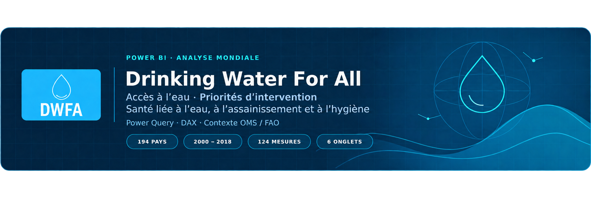

# Drinking Water For All • Power BI

🌐 [Lire ce README en français](README.fr.md)

A drinking-water access analysis project for **Drinking Water For All (DWFA)**, developed as part of the **OpenClassrooms Data Analyst program**. The report combines service levels, demographics, health related to water, sanitation and hygiene, and political stability to explore the need for new and improved water services.

**WASH** stands for **Water, Sanitation and Hygiene**. The documentation uses this term for health indicators associated with these three areas.

The reference scope covers **194 countries** over **19 years, from 2000 to 2018**. Additional **WHO / FAO** data provide context on sanitation, hygiene and land area.

**Power BI Desktop • Power Query / M • DAX • PBIP • Optional Python checks**

The report interface and the detailed Power Query and DAX guides are in **French**. Technical table, column and measure names are preserved throughout the documentation.

## Project documentation

| Guide | Contents |
|---|---|
| [Power Query • Prepare the data](power-query/README.md) — French | Sources, parameters, 25 queries, table loading and relationships |
| [DAX • Build the indicators](dax/README.md) — French | 10 files in creation order, 124 measures, formats, display folders and the 6 report pages |
| [Power BI • Open and version the project](power-bi/README.md) — English | PBIP project, initial model, dark theme and files to track in Git |

The repository is built incrementally: **data preparation and the theme**, followed by **measures and report pages**. The six pages and 124 measures described here represent the final scope; they become available as each build stage is completed.

## Business objectives

| Area | Questions supported by the report |
|---|---|
| **New services** | Which countries have the greatest need for at least basic drinking-water services? How many people are affected? |
| **Service upgrades** | Where is there a gap between basic and safely managed access, using the same available-data cohort? |
| **Advisory support** | How do countries compare in drinking-water access, WASH health and political stability? |
| **Data quality** | Which indicators are available, for which countries and with what population coverage? |

The indicators support exploration and comparison. The access-health profile is exploratory; it does not measure the causal effectiveness of public policy.

## The six report pages

The names below match the French report interface.

| Page | Purpose |
|---|---|
| **Monde • Synthèse** | Indicators for the selected scope, access trends and exploratory comparisons |
| **Monde • Carte** | Health-priority Top 5 / Top 10 and map, worldwide or within a selected WHO region |
| **Vue continentale** | Comparison of countries and service levels within a continent |
| **Vue nationale** | A country profile covering population, total / urban / rural access, health and stability |
| **Qualité des données** | Series availability, indicator coverage and population consistency |
| **Contexte OMS / FAO** | Sanitation, hygiene, land area, density and external-data coverage |

The **Ocean Accents** theme combines a dark background with cyan, violet, green and pink accents. KPI cards can use a colored stripe on the left; figures and tables use the color measures from the DAX folder.

Color meaning depends on the indicator: improved access can be green, while high intervention needs or mortality remain pink. Labels and coverage figures provide context alongside the colors.

## Data and provenance

| Source | Data used |
|---|---|
| Initial project datasets | Total / urban / rural population, basic and safely managed access, WASH-attributed mortality, estimated deaths, political stability and WHO regions |
| Project geography reference | Country-name, ISO3-code and continent mappings |
| Additional WHO data | Basic sanitation access and basic household hygiene facilities |
| FAO / FAOSTAT data | Land area, combined with population to calculate density |

Initial inputs are stored in `data/raw/`, the geography reference in `data/reference/`, and WHO / FAO extracts in `data/external/`.

The [external-source manifest](data/external/source_manifest.json) records filenames, URLs, retrieval dates and SHA-256 hashes for the supplied snapshots. The additional data were retrieved on **October 5, 2026**, and cover the historical **2000–2018** scope.

The **Fichiers bruts** mode processes the WHO JSON files and FAO ZIP directly in Power Query. This mode does not require a CSV cleaned with Python. **OMS** is the French abbreviation for **WHO**, used in the report labels and source filenames.

## Repository structure

| Location | Purpose |
|---|---|
| `README.md` | English project overview and links to the guides |
| `README.fr.md` | French translation of the project overview |
| `assets/images/` | Banner and visual assets |
| `power-query/` | 25 M scripts and the data-preparation guide |
| `dax/` | 10 ordered DAX files and the measure catalog |
| `power-bi/project/` | `DWFA.pbip` entry point, report and semantic model |
| `power-bi/themes/` | `DWFA_Ocean_Accents.json` theme and the earlier variant |
| `data/raw/` | Initial project source files |
| `data/reference/` | Geography reference retained for traceability |
| `data/external/` | WHO / FAO extracts and provenance manifest |

The `scripts/`, `data/processed/` and `validation/` folders complement the project when Python checks are added. Processed files and check results are reproducible outputs, separate from source inputs.

## Data model

The star schema uses **one row per country and year**. The reference snapshot contains **3,686 rows** in `Fact_CountryYear`.

| Table | Purpose | Loading / relationships |
|---|---|---|
| `Fact_CountryYear` | Population, access, health, stability and external context | Loaded; many side of both relationships |
| `Dim_Country` | Country, ISO3, continent and WHO region | Loaded; filters facts through `Country` |
| `Dim_Year` | Years from 2000 to 2018 | Loaded; filters facts through `Year` |
| `Param_Stability` | Minimum political-stability threshold | Loaded; disconnected |
| `Param_StabilityMode` | Enables the stability threshold | Loaded; disconnected |
| `Param_PriorityTopN` | Chooses a health-priority Top 5 or Top 10 | DAX calculated table; disconnected |
| `_Measures` | Technical container for DAX measures | Created at the DAX stage; disconnected, with its technical column hidden |

Both relationships are **active, one-to-many and single-direction**:

- `Dim_Country[Country]` (1) → `Fact_CountryYear[Country]` (*) ;
- `Dim_Year[Year]` (1) → `Fact_CountryYear[Year]` (*).

Power Query prepares the five imported data and parameter tables. The DAX stage adds `_Measures` and `Param_PriorityTopN`, bringing the final model to seven tables. Relationships belong to the Power BI model. Functions, source parameters, staging queries and `QA_MissingData` remain unloaded in the model.

`Dim_Year` is an annual dimension. Auto date/time is disabled for this project.

## Reproduce the project

### 1 • Prepare the data

Follow the [Power Query README](power-query/README.md) to create all 25 queries and configure the parameters:

| Parameter | Value to configure |
|---|---|
| `pDataFolder` | Absolute path to `data/raw` |
| `pExternalFolder` | Absolute path to `data/external` |
| `pExternalSourceMode` | `Fichiers bruts` to use the supplied source snapshots |

Create all queries before refreshing, preserve their names, and enable loading only for `Fact_CountryYear`, `Dim_Country`, `Dim_Year`, `Param_Stability` and `Param_StabilityMode`. Apply the transformations, then check the relationships.

### 2 • Open the PBIP and apply the theme

When the project is available in the repository, open [DWFA.pbip](power-bi/project/DWFA.pbip), keeping its report and semantic-model folders beside the entry point. Update local source paths before refreshing.

For a manual rebuild, apply [DWFA_Ocean_Accents.json](power-bi/themes/DWFA_Ocean_Accents.json) through **View > Themes > Browse for themes**, then save the project as PBIP.

Disable **Auto date/time** under **Current File > Data Load** in the Power BI options. Rates are stored between 0 and 1 and displayed as percentages. Set their default summarization, as well as stability and the threshold, to **Do not summarize**; DAX measures provide the appropriate calculations.

### 3 • Create measures and pages incrementally

Follow the [DAX README](dax/README.md). Create `_Measures` and `Param_PriorityTopN` separately using the two `00` files through **Modeling > New table**. Keep both tables disconnected and hide `_Measures[_Placeholder]`. Set `Param_PriorityTopN[TopN]` to a whole number, format `0`, with **Do not summarize**. Then select `_Measures` and create the measures from `01` through `08`, from top to bottom within each file. Copy **one measure definition at a time** into **New measure**, then set its format and display folder.

| Stage | DAX files | Pages added | Cumulative measures |
|---|---|---|---:|
| Technical foundation | Both `00` files | `_Measures` and `Param_PriorityTopN` tables | 0 |
| World views | `01` through `04` | Monde • Synthèse and Monde • Carte, including the health-priority Top | 52 |
| Geographic views | `05` | Vue continentale and Vue nationale | 65 |
| Data quality | `06` | Qualité des données | 91 |
| Analytical complements | `07` | Additional new-service and upgrade calculations for existing pages | 102 |
| External context | `08` | Contexte OMS / FAO | 124 |

The final model contains **124 measures, including 31 color measures**. The 10 DAX files comprise two table definitions and eight measure files. File `07` adds analytical complements without creating a separate report page. Shared measures are reused on later pages. DAX formulas do not automatically create visuals; the guide describes their construction and formatting.

### 4 • Refresh with updated files

Place updated source files in the configured folders, preserve the expected column structure, and refresh in Power BI. For WHO / FAO extracts, `fxLatestExternalFile` selects the most recently modified matching files, using the filename as a tie-breaker.

A new snapshot can change results and coverage. Extending the analysis to new years or countries also requires changes to the query scope and dimensions; replacing files alone does not automatically expand the model.

## Interpret the indicators

- **Missing data**: missing observations remain missing; they are not replaced with zero.
- **Weighted access**: rates use countries with both the indicator and a relevant positive population. Coverage shows the population actually represented.
- **Service levels**: at least basic access includes safely managed access. Upgrade comparisons use a shared cohort to avoid subtracting rates based on different country sets.
- **WASH health**: mortality observations in the supplied snapshot are available for **2016 only** and concern water, sanitation and hygiene. They must not be extrapolated to other years.
- **Demographics**: source populations are converted to persons once. Urban share uses `urban / (urban + rural)`; differences from source totals remain visible in the checks.
- **Geography**: continents and WHO administrative regions are separate classifications.
- **Land area**: FAO values in thousands of hectares are converted to km². Density uses available population and land area for the same set of countries.
- **Stability**: the threshold applies only when enabled; countries without a stability index are then excluded from the filtered scope.

Select **one year** for KPI cards. **2016** allows mortality indicators to be reviewed alongside the other data families. Low coverage or an unavailable year can explain a blank visual.

### Health-priority ranking

On **Monde • Carte**, the Top 5 / Top 10 is available for **2016 only**. It ranks countries within the selected geographic scope by descending WASH mortality per 100,000 people, comparing rates to six decimal places. Ties use estimated deaths in descending order, then country name alphabetically. Classifiable countries require a known, strictly positive mortality rate and a positive population, and must meet the stability rule when enabled. Missing stability values are excluded in that mode.

The map and list show the same Top. Bubble size represents the **mortality rate**, while the table also displays estimated deaths and stability. The upper KPI cards describe the full eligible scope or the clicked country, rather than only the Top countries. If fewer than N countries qualify, the report displays fewer than N. The default Top is 10 when the parameter has no single valid selection.

The stability threshold is an analytical selection setting. It does not guarantee the safety or feasibility of an intervention. The ranking supports a shortlist for further investigation, which requires local evidence and field assessment.

## Checks and version control

Python scripts reproduce preparation steps and reference calculations for comparison with the model. **Power Query and DAX can build and refresh the report without Python.** Python checks do not replace formula execution and visual review in Power BI Desktop.

At each stage, check the refresh, results, filters, coverage and visual display before saving the PBIP. Reference-snapshot figures are comparison points; they are not hard-coded into measures.

Git tracks scripts, documentation, selected source inputs, themes and native PBIP project definitions. The `cache.abf` cache and personal `localSettings.json` settings are excluded. A clone without a cache must be refreshed to load its data.

## Technical documentation

- [Power Query M • Microsoft Learn](https://learn.microsoft.com/powerquery-m/)
- [Star schema • Microsoft Learn](https://learn.microsoft.com/power-bi/guidance/star-schema)
- [Report themes • Microsoft Learn](https://learn.microsoft.com/power-bi/create-reports/desktop-report-themes)
- [Power BI Desktop projects • Microsoft Learn](https://learn.microsoft.com/power-bi/developer/projects/projects-overview)
- [Auto date/time • Microsoft Learn](https://learn.microsoft.com/power-bi/transform-model/desktop-auto-date-time)
