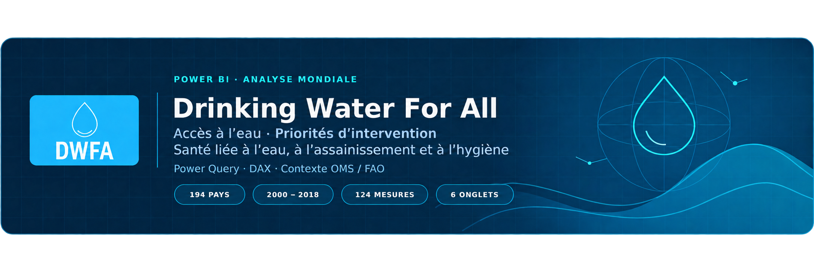

# DAX DWFA • Accès à l’eau et priorités d’intervention

Ce dossier documente les formules du modèle sémantique DWFA : **124 mesures**, la table technique `_Measures` et le paramètre déconnecté `Param_PriorityTopN`. Il accompagne les six pages du rapport : **Monde · Synthèse**, **Monde · Carte**, **Vue continentale**, **Vue nationale**, **Qualité des données** et **Contexte OMS / FAO**.

Les fichiers `.dax` servent à lire, versionner et reproduire les formules. Power BI ne les importe pas automatiquement. Dans le projet `.pbip`, les définitions actives du modèle se trouvent dans `DWFA.SemanticModel/definition`.

La préparation des sources, les rapprochements géographiques et le chargement des tables sont décrits dans le [README Power Query](../power-query/README.md).

## Modèle et grain des données

| Table | Rôle | Grain / relation |
| --- | --- | --- |
| `Fact_CountryYear` | Table de faits : population, accès à l’eau, mortalité, stabilité et compléments OMS/FAO | Une ligne par pays et année, contrôlée par `CountryYearKey` |
| `Dim_Country` | Dimension géographique : pays, ISO3, continent et région OMS | Une ligne par `Country`, côté 1 de la relation vers `Fact_CountryYear[Country]` |
| `Dim_Year` | Dimension temporelle | Une ligne par année, côté 1 de la relation vers `Fact_CountryYear[Year]` |
| `Param_Stability` | Seuil minimal choisi par l’utilisateur | Sans relation ; valeur lue dans les mesures |
| `Param_StabilityMode` | Choix entre tous les pays et application du seuil | Sans relation ; valeur lue dans les mesures |
| `Param_PriorityTopN` | Choix du nombre de pays affichés : 5 ou 10 | Table calculée DAX, sans relation |
| `_Measures` | Conteneur technique des mesures | Sans relation, colonne `_Placeholder` masquée |

Les dimensions filtrent la table de faits : cette partie du modèle forme une étoile. Les paramètres ne décrivent pas des observations ; ils transmettent des choix de lecture aux mesures avec `SELECTEDVALUE`. Leur absence de relation est donc volontaire. Les dossiers d’affichage des mesures n’ajoutent aucune table ni relation.

Les requêtes Power Query, les colonnes importées et les deux relations métier doivent exister avant la création des mesures. Les tables `Param_Stability` et `Param_StabilityMode` sont déjà préparées dans le parcours Power Query. Les fichiers DAX ci-dessous ne remplacent pas cette préparation.

## Organisation des fichiers

Les fichiers suivent un **ordre de création progressif**. Créer les deux tables `00`, puis les mesures des fichiers `01` à `08`, de haut en bas à l’intérieur de chaque fichier.

| Fichier | Objets | Rôle |
| --- | ---: | --- |
| `00_Create_Measures_Table.dax` | 1 table | Créer `_Measures` et masquer `_Placeholder` |
| `00_Create_PriorityTopN_Table.dax` | 1 table | Créer le paramètre déconnecté Top 5 / Top 10 |
| `01_Common_Context_And_Population.dax` | 10 mesures | Année, seuil, mode de stabilité, population et choix du Top |
| `02_World_Water_Access_And_Coverage.dax` | 9 mesures | Accès basique, service sûr, couverture et cohorte comparable |
| `03_World_Health_And_Intervention.dax` | 13 mesures | Mortalité, stabilité, besoins et classement sanitaire |
| `04_World_Presentation_And_Colors.dax` | 20 mesures | Libellés, variation annuelle, couleurs et bandeaux de la carte |
| `05_Continental_And_National_Views.dax` | 13 mesures | Accès urbain/rural, niveaux exclusifs de service et contexte géographique |
| `06_Data_Quality.dax` | 26 mesures | Disponibilité, couverture et contrôles de cohérence |
| `07_Intervention_Priorities.dax` | 11 mesures | Compléments analytiques pour la création et la modernisation |
| `08_WHO_FAO_Context.dax` | 22 mesures | Assainissement, hygiène, superficie, densité et couverture des compléments |

Après les deux fichiers `00` et les fichiers `01` à `04`, les **52 mesures de la première étape** sont disponibles : les pages Monde · Synthèse et Monde · Carte, y compris le Top sanitaire, peuvent être construites. Le fichier `05` complète les vues continentale et nationale, puis `06` la page Qualité et `08` la page Contexte OMS / FAO.

Le fichier `07` conserve les compléments de création et de modernisation du modèle. Il ne correspond pas à un onglet supplémentaire : le rapport comporte bien six pages. Les indicateurs de besoin en personnes ne doivent pas être confondus avec le classement sanitaire de la carte.

### Dossiers d’affichage

Toutes les mesures restent dans **la même table `_Measures`**. Les dossiers `Population`, `Accès eau`, `Santé`, `Stabilité`, `Évolution`, `Qualité`, `Création`, `Modernisation`, `Consulting`, `Priorités`, `Priorités sanitaires` et `Compléments OMS FAO` les regroupent par fonction. Certains possèdent des sous-dossiers, par exemple `Qualité\Disponibilité`.

- **Pilotage** contient 11 mesures : année et paramètres, sélection valide, visibilité des points et filtre du Top.
- **Présentation** contient 12 mesures : libellés de contexte, couverture et bandeaux sanitaires.
- **Présentation visuelle** contient 31 mesures de couleur, réparties entre couleurs générales, couverture et disponibilité.

Le nom du fichier indique l’étape de construction ; il ne fixe pas le dossier d’affichage dans Power BI. Le catalogue ci-dessous précise le dossier de chacune des 124 mesures. Les libellés français d’une carte ou d’une colonne peuvent différer du nom technique de sa mesure ; modifier ce libellé dans un visuel ne renomme pas la mesure dans le modèle.

## Règles de calcul et interprétation

### Année et stabilité

`Analysis Year` attend une seule année pour les KPI. Sur une courbe temporelle, chaque point de l’axe fournit son année. Si aucune année unique n’est disponible dans le contexte, les indicateurs protégés peuvent rester vides et les libellés invitent à préciser la sélection.

`Stability Minimum` lit le seuil choisi et utilise **−2,5** par défaut. `Stability Filter Enabled` active le filtre uniquement en mode **Appliquer le seuil**. En mode **Tous les pays**, changer le seuil ne modifie pas les résultats.

Lorsque le seuil est activé, un pays est retenu pour l’année étudiée si son indice de stabilité est renseigné et **supérieur ou égal** au minimum. Un indice absent est exclu dans ce mode. Relever le minimum rend la sélection plus restrictive. L’indice est un critère analytique de présélection ; il ne garantit pas les conditions de sécurité ou la faisabilité d’une intervention.

### Population, taux et couverture

Les populations sont exprimées en personnes dans les calculs. L’affichage en millions est un réglage du visuel ; il ne modifie pas l’unité source.

- Les taux d’accès agrégés sont pondérés par la population correspondant au milieu étudié. Seuls les pays ayant un taux renseigné et une population de pondération positive participent à la moyenne.
- La part urbaine utilise `population urbaine / (population urbaine + population rurale)`, sur les pays où ces deux valeurs sont renseignées.
- La couverture en pays compte les pays disposant de l’indicateur selon les conditions de la mesure. La couverture en population indique la part de la population du périmètre effectivement représentée.
- Une couverture partielle doit être conservée dans la lecture d’un agrégat : le taux des pays renseignés ne devient pas celui des pays sans données. Un affichage arrondi à 100,0 % ne prouve pas que tous les pays sont renseignés.
- Les agrégats urbains, ruraux, basiques, sûrs ou externes peuvent utiliser des cohortes différentes. Les calculs de comparaison basique/sûr utilisent une cohorte commune quand leur formule l’exige.

Les taux d’accès sont des ratios dans le modèle : `0,894` s’affiche **89,4 %**. La variation annuelle `Basic Access Change pp` est en **points de pourcentage** : passer de 80 % à 82 % représente **+2 pp**, pas une hausse de 2 %.

Une donnée absente reste différente d’un zéro observé. Les formules utilisant explicitement `COALESCE` affichent zéro pour certains comptages ; les indicateurs non évaluables peuvent rester vides.

### Santé et priorités d’intervention

`Mortality Rate Weighted` exprime un taux de mortalité lié à l’eau, à l’assainissement et à l’hygiène • WASH • pour **100 000 habitants**, pondéré par la population des pays renseignés. `WASH Deaths` additionne les valeurs disponibles de la colonne `WASHDeaths`, affichées dans le rapport comme décès WASH estimés. Le taux et le nombre de décès répondent à des questions différentes.

La mortalité du projet est disponible **en 2016 uniquement**. Le Top sanitaire ne reporte jamais cette observation sur une autre année.

| Élément du Top sanitaire | Règle |
| --- | --- |
| Périmètre | Monde ou sélection géographique conservée par `ALLSELECTED` |
| Année | 2016 uniquement ; aucun rang hors de cette année |
| Pays classables | Mortalité strictement positive, population positive et respect du mode de stabilité |
| Premier critère | Taux de mortalité décroissant, comparé à six décimales |
| Départage | Décès décroissants, puis nom de pays alphabétique |
| Nombre de pays | 5 ou 10 ; défaut 10 si le paramètre n’a pas une sélection unique valide |
| Bulles de la carte | Taille proportionnelle au taux de mortalité des pays du Top |
| Filtre des visuels | `Health Priority In Top N` égal à 1 |

Le rang est recalculé à l’intérieur de la région sélectionnée. Les régions OMS et les continents sont deux regroupements distincts. Si moins de N pays sont classables, la liste en contient moins de N. Une mortalité connue égale à zéro n’est pas une priorité à mortalité positive. Des décès non renseignés n’empêchent pas le classement d’un taux connu ; en cas d’égalité de taux, ils sont départagés après les décès renseignés.

Le bandeau distingue les pays classables, ceux sous le seuil, ceux sans indice et ceux admissibles mais sans mortalité. Les compteurs « sous le seuil » et « sans indice » portent sur les pays ayant une mortalité positive et une population positive. Ces catégories ne constituent pas une partition exhaustive de tous les pays.

Les autres analyses du rapport restent complémentaires :

- **Création** : `Creation Need People` reprend le nombre de personnes sans service basique.
- **Modernisation** : les besoins et écarts basique/sûr sont calculés sur les pays disposant des deux indicateurs. Les trois niveaux exclusifs sont service sûr, basique sans sûr et sous le niveau basique.
- **Consulting** : `Access Health Profile Score` est un profil exploratoire combinant à parts égales l’accès basique et une transformation de la mortalité. Ce profil n’est pas le critère de tri du Top sanitaire et ne mesure pas un effet causal des politiques publiques.

Les mesures `Creation Top 10 People` et `Modernization Top 10 People` portent sur des besoins absolus en personnes. Elles sont distinctes du Top sanitaire, fondé d’abord sur le taux de mortalité. Les observations historiques aident à comparer les pays du jeu de données ; elles ne constituent pas un état opérationnel actualisé.

### Qualité et compléments OMS / FAO

Les indicateurs de disponibilité distinguent **Disponible**, **Absente** et les cas hors périmètre. `Population Consistency Status` signale un écart absolu supérieur à 1 % entre urbain + rural et total. Ce contrôle ne corrige pas arbitrairement les données sources.

Les compléments d’assainissement et d’hygiène sont pondérés par la population du brief sur les pays renseignés ; ce ne sont pas des agrégats officiels OMS reproduits tels quels. La densité agrégée utilise **la somme des populations / la somme des superficies terrestres disponibles**, avec population et superficie positives. Elle n’est pas la moyenne simple des densités nationales.

Les mesures de couverture propres à chaque complément restent visibles afin de signaler les cohortes variables et les absences.

### Couleurs

Les mesures `UI … Color` renvoient des chaînes hexadécimales à utiliser en mise en forme conditionnelle **Valeur de champ**. Leur création ne colore pas automatiquement les visuels.

| Couleur | Lecture selon l’indicateur |
| --- | --- |
| Vert | Accès positif, variation positive, donnée disponible ou charge nulle observée |
| Rose | Charge sanitaire ou besoin positif, variation négative ou donnée absente signalée |
| Ambre | Couverture partielle ou contrôle nécessitant une lecture prudente |
| Gris | Absence de résultat, zéro neutre ou cas hors périmètre selon la mesure |
| Cyan / violet | Population, part urbaine ou séries distinctes suivant le visuel |

Pour l’indice de stabilité, vert/rose indique le signe de la valeur et non son admissibilité au seuil. Un pays à indice négatif peut donc rester dans le classement si son indice est supérieur ou égal au minimum choisi. Les textes et valeurs complètent la couleur.

## Filtres et interactions du rapport

Les interactions sont des réglages des visuels du rapport ; les fichiers DAX ne les créent pas.

- Les KPI et les comparaisons décrivent l’année sélectionnée. Les courbes historiques conservent les années disponibles ; elles restent filtrées par le pays, la région/continent et le mode de stabilité.
- Sur Monde · Carte, Top 5 / Top 10 limite la carte et la liste. Les KPI supérieurs décrivent le périmètre admissible complet, ou le pays cliqué, pas seulement les pays du Top.
- Cliquer un pays sur la carte ou dans le classement actualise ses KPI sans réduire la cohorte du classement à une seule ligne. La carte conserve l’aperçu des priorités.
- Changer la région OMS recalcule le classement dans cette région. Le bandeau indique l’année et le périmètre.
- Une sélection autre que 2016 rend le Top sanitaire indisponible tout en laissant les autres indicateurs fonctionner selon leurs propres données.

## Utilisation du dossier

Si le projet fourni contient déjà les 124 mesures et le paramètre Top N, il n’est pas nécessaire de les recréer. Pour consulter une formule, sélectionner sa mesure dans `_Measures`.

Pour une reconstruction manuelle :

1. Préparer les tables métier et les deux relations avec le parcours Power Query.
2. Créer séparément les tables des deux fichiers `00` avec **Modélisation > Nouvelle table** ; masquer `_Measures[_Placeholder]`.
3. Laisser `_Measures` et les trois paramètres sans relation. Pour `Param_PriorityTopN[TopN]`, choisir nombre entier, format `0` et **Ne pas résumer**.
4. Sélectionner `_Measures` et créer les mesures des fichiers `01` à `08` dans l’ordre. Copier **un seul bloc `Nom = formule` à la fois** dans **Nouvelle mesure**. Ne pas coller tout un fichier contenant plusieurs définitions.
5. Appliquer les formats et dossiers d’affichage du catalogue. La barre oblique inverse sépare les niveaux d’un dossier, par exemple `Qualité\Couverture`.
6. Construire les visuels, leurs tris et leurs filtres. Régler les couleurs par valeur de champ et les interactions attendues.

Les mesures contenant `ALLSELECTED`, `REMOVEFILTERS`, `CALCULATE`, `HASONEVALUE` ou `SELECTEDVALUE` doivent conserver leur formule complète pour préserver le contexte de calcul. Aucun rôle RLS ou colonne calculée métier supplémentaire n’est créé par ce dossier.

## Contrôles de cohérence

Les 124 expressions du dossier correspondent à celles du dernier PBIP transmis, après normalisation des espaces et commentaires. Les mesures ne sont ni renommées ni dupliquées et leurs dépendances sont disponibles avant leur création. Cette vérification statique ne remplace pas l’exécution dans Power BI Desktop.

Dans les captures de référence, en **2016**, mode **Tous les pays**, les repères de qualité sont **194 pays admissibles**, **192 pays avec accès basique**, **98 avec service sûr**, **183 avec mortalité WASH** et **190 avec stabilité**. Ils dépendent des données et des filtres ; ils ne sont pas écrits comme résultats constants dans les formules.

Avec le monde entier, 2016 et le seuil actif à −2,5, le Top 5 sanitaire des captures commence par **Chad, Somalia, Central African Republic, Sierra Leone et Niger**. Vérifier également :

- Top 5 identique aux cinq premières lignes du Top 10 à filtres identiques ;
- classement régional recalculé à partir du rang 1 ;
- exclusion des pays sous le seuil actif et gestion distincte des indices absents ;
- aucun classement sanitaire en 2017 ;
- évolution historique visible malgré l’année sélectionnée pour les KPI ;
- conservation du classement lors d’un clic sur un pays ;
- données absentes conservées et couverture partielle signalée.

## Catalogue des mesures

Les noms sont les noms techniques exacts. Le format est celui du modèle de référence ; **Général / texte** signifie qu’aucun format explicite n’est défini. Les formats en points de pourcentage sont numériques, sans format `%`. L’ordre des tableaux ci-dessous respecte l’ordre de création dans chaque fichier.

### 01_Common_Context_And_Population.dax

| Ordre | Mesure | Format | Dossier d’affichage |
| ---: | --- | --- | --- |
| 1 | `Analysis Year` | `0` | Pilotage |
| 2 | `Stability Minimum` | `0.0` | Pilotage |
| 3 | `Stability Filter Enabled` | `0` | Pilotage |
| 4 | `Population Total` | `#,0` | Population |
| 5 | `Population Urban` | `#,0` | Population |
| 6 | `Population Rural` | `#,0` | Population |
| 7 | `Urban Population Share` | `0.0%` | Population |
| 8 | `Countries Included` | `0` | Qualité |
| 9 | `Eligible Country` | `0` | Pilotage |
| 10 | `Priority Top N` | `0` | Pilotage |

### 02_World_Water_Access_And_Coverage.dax

| Ordre | Mesure | Format | Dossier d’affichage |
| ---: | --- | --- | --- |
| 11 | `Basic Access Total` | `0.0%` | Accès eau\Total |
| 12 | `Safe Access Total` | `0.0%` | Accès eau\Total |
| 13 | `Basic Countries Covered` | `0` | Qualité |
| 14 | `Basic Population Coverage` | `0.0%` | Qualité |
| 15 | `People Without Basic Service` | `#,0` | Accès eau\Impact |
| 16 | `Safe Countries Covered` | `0` | Qualité |
| 17 | `Safe Population Coverage` | `0.0%` | Qualité |
| 18 | `Basic Access Comparable` | `0.0%` | Modernisation |
| 19 | `Safe Access Comparable` | `0.0%` | Modernisation |

### 03_World_Health_And_Intervention.dax

| Ordre | Mesure | Format | Dossier d’affichage |
| ---: | --- | --- | --- |
| 20 | `Political Stability Mean` | `0.00` | Stabilité |
| 21 | `Mortality Rate Weighted` | `0.00` | Santé |
| 22 | `WASH Deaths` | `#,0` | Santé |
| 23 | `Access Health Profile Score` | `0.0` | Consulting |
| 24 | `Creation Need People` | `#,0` | Création |
| 25 | `Health Priority Rate` | `0.00` | Priorités sanitaires |
| 26 | `Health Priority Rank` | `0` | Priorités sanitaires |
| 27 | `Health Priority In Top N` | `0` | Pilotage |
| 28 | `Health Priority Map Size` | `0.00` | Priorités sanitaires |
| 29 | `Health Priority Candidate Count` | `0` | Priorités sanitaires |
| 30 | `Health Priority Excluded Stability Count` | `0` | Priorités sanitaires |
| 31 | `Health Priority Unknown Stability Count` | `0` | Priorités sanitaires |
| 32 | `Health Priority Missing Mortality Count` | `0` | Priorités sanitaires |

### 04_World_Presentation_And_Colors.dax

| Ordre | Mesure | Format | Dossier d’affichage |
| ---: | --- | --- | --- |
| 33 | `Year Label` | `Général / texte` | Présentation |
| 34 | `Mortality Availability Label` | `Général / texte` | Présentation |
| 35 | `Basic Coverage Label` | `Général / texte` | Présentation |
| 36 | `Safe Coverage Label` | `Général / texte` | Présentation |
| 37 | `Stability Filter Label` | `Général / texte` | Présentation |
| 38 | `Basic Access Previous Year` | `0.0%` | Évolution |
| 39 | `Basic Access Change pp` | `0.0` | Évolution |
| 40 | `UI Population Color` | `Général / texte` | Présentation visuelle\Couleurs |
| 41 | `UI Urban Share Color` | `Général / texte` | Présentation visuelle\Couleurs |
| 42 | `UI Basic Access Color` | `Général / texte` | Présentation visuelle\Couleurs |
| 43 | `UI Safe Access Color` | `Général / texte` | Présentation visuelle\Couleurs |
| 44 | `UI Stability Color` | `Général / texte` | Présentation visuelle\Couleurs |
| 45 | `UI Basic Change Color` | `Général / texte` | Présentation visuelle\Couleurs |
| 46 | `UI Mortality Color` | `Général / texte` | Présentation visuelle\Couleurs |
| 47 | `UI WASH Deaths Color` | `Général / texte` | Présentation visuelle\Couleurs |
| 48 | `UI Basic Coverage Color` | `Général / texte` | Présentation visuelle\Couverture |
| 49 | `UI Safe Coverage Color` | `Général / texte` | Présentation visuelle\Couverture |
| 50 | `Health Priority Country Label` | `Général / texte` | Présentation |
| 51 | `Health Priority Scope Label` | `Général / texte` | Présentation |
| 52 | `Health Priority Status Label` | `Général / texte` | Présentation |

### 05_Continental_And_National_Views.dax

| Ordre | Mesure | Format | Dossier d’affichage |
| ---: | --- | --- | --- |
| 53 | `Basic Access Urban` | `0.0%` | Accès eau\Urban |
| 54 | `Basic Access Rural` | `0.0%` | Accès eau\Rural |
| 55 | `Safe Access Urban` | `0.0%` | Accès eau\Urban |
| 56 | `Safe Access Rural` | `0.0%` | Accès eau\Rural |
| 57 | `People Without Safe Service` | `#,0` | Accès eau\Impact |
| 58 | `Basic Only Share` | `0.0%` | Modernisation |
| 59 | `Below Basic Share` | `0.0%` | Modernisation |
| 60 | `Modernization Gap pp` | `0.0` | Modernisation |
| 61 | `Urban Rural Access Gap pp` | `0.0` | Accès eau\Écarts |
| 62 | `Selected Country Label` | `Général / texte` | Présentation |
| 63 | `Selected Continent Label` | `Général / texte` | Présentation |
| 64 | `National Selection Valid` | `0` | Pilotage |
| 65 | `Continental Selection Valid` | `0` | Pilotage |

### 06_Data_Quality.dax

| Ordre | Mesure | Format | Dossier d’affichage |
| ---: | --- | --- | --- |
| 66 | `Population Ventilation Gap pp` | `0.0` | Qualité |
| 67 | `Stability Countries Covered` | `0` | Qualité |
| 68 | `Mortality Population Coverage` | `0.0%` | Qualité |
| 69 | `Mortality Countries Covered` | `0` | Qualité |
| 70 | `Basic Country Coverage` | `0.0%` | Qualité\Couverture |
| 71 | `Safe Country Coverage` | `0.0%` | Qualité\Couverture |
| 72 | `Mortality Country Coverage` | `0.0%` | Qualité\Couverture |
| 73 | `Stability Country Coverage` | `0.0%` | Qualité\Couverture |
| 74 | `Population Data Status` | `Général / texte` | Qualité\Disponibilité |
| 75 | `Basic Data Status` | `Général / texte` | Qualité\Disponibilité |
| 76 | `Safe Data Status` | `Général / texte` | Qualité\Disponibilité |
| 77 | `Mortality Data Status` | `Général / texte` | Qualité\Disponibilité |
| 78 | `Stability Data Status` | `Général / texte` | Qualité\Disponibilité |
| 79 | `Population Consistency Status` | `Général / texte` | Qualité\Population |
| 80 | `Quality Summary Label` | `Général / texte` | Présentation |
| 81 | `UI Countries Color` | `Général / texte` | Présentation visuelle\Couleurs |
| 82 | `UI Basic Countries Color` | `Général / texte` | Présentation visuelle\Couverture |
| 83 | `UI Safe Countries Color` | `Général / texte` | Présentation visuelle\Couverture |
| 84 | `UI Mortality Countries Color` | `Général / texte` | Présentation visuelle\Couverture |
| 85 | `UI Stability Countries Color` | `Général / texte` | Présentation visuelle\Couverture |
| 86 | `UI Population Status Color` | `Général / texte` | Présentation visuelle\Disponibilité |
| 87 | `UI Basic Status Color` | `Général / texte` | Présentation visuelle\Disponibilité |
| 88 | `UI Safe Status Color` | `Général / texte` | Présentation visuelle\Disponibilité |
| 89 | `UI Mortality Status Color` | `Général / texte` | Présentation visuelle\Disponibilité |
| 90 | `UI Stability Status Color` | `Général / texte` | Présentation visuelle\Disponibilité |
| 91 | `UI Population Consistency Color` | `Général / texte` | Présentation visuelle\Disponibilité |

### 07_Intervention_Priorities.dax

| Ordre | Mesure | Format | Dossier d’affichage |
| ---: | --- | --- | --- |
| 92 | `Comparable Population Coverage` | `0.0%` | Qualité |
| 93 | `Modernization Need People` | `#,0` | Modernisation |
| 94 | `Creation Rank` | `0` | Création |
| 95 | `Creation Point Visible` | `0` | Pilotage |
| 96 | `Modernization Point Visible` | `0` | Pilotage |
| 97 | `Consulting Point Visible` | `0` | Pilotage |
| 98 | `Creation Top 10 People` | `#,0` | Priorités |
| 99 | `Modernization Top 10 People` | `#,0` | Priorités |
| 100 | `Priority Scope Label` | `Général / texte` | Présentation |
| 101 | `UI Creation Need Color` | `Général / texte` | Présentation visuelle\Couleurs |
| 102 | `UI Modernization Need Color` | `Général / texte` | Présentation visuelle\Couleurs |

### 08_WHO_FAO_Context.dax

| Ordre | Mesure | Format | Dossier d’affichage |
| ---: | --- | --- | --- |
| 103 | `Sanitation Basic Access Total` | `0.0%` | Compléments OMS FAO\WASH |
| 104 | `Sanitation Countries Covered` | `0` | Compléments OMS FAO\Couverture |
| 105 | `Sanitation Population Coverage` | `0.0%` | Compléments OMS FAO\Couverture |
| 106 | `Hygiene Basic Access Total` | `0.0%` | Compléments OMS FAO\WASH |
| 107 | `Hygiene Countries Covered` | `0` | Compléments OMS FAO\Couverture |
| 108 | `Hygiene Population Coverage` | `0.0%` | Compléments OMS FAO\Couverture |
| 109 | `Land Area Covered Km2` | `#,0.0` | Compléments OMS FAO\Densité |
| 110 | `Population Density Covered` | `0.0` | Compléments OMS FAO\Densité |
| 111 | `Density Countries Covered` | `0` | Compléments OMS FAO\Couverture |
| 112 | `Density Population Coverage` | `0.0%` | Compléments OMS FAO\Couverture |
| 113 | `Sanitation Data Status` | `Général / texte` | Compléments OMS FAO\Disponibilité |
| 114 | `Hygiene Data Status` | `Général / texte` | Compléments OMS FAO\Disponibilité |
| 115 | `Land Area Data Status` | `Général / texte` | Compléments OMS FAO\Disponibilité |
| 116 | `External Context Label` | `Général / texte` | Compléments OMS FAO\Présentation |
| 117 | `UI Sanitation Color` | `Général / texte` | Présentation visuelle\Couleurs |
| 118 | `UI Hygiene Color` | `Général / texte` | Présentation visuelle\Couleurs |
| 119 | `UI Density Color` | `Général / texte` | Présentation visuelle\Couleurs |
| 120 | `UI Land Area Color` | `Général / texte` | Présentation visuelle\Couleurs |
| 121 | `UI Sanitation Coverage Color` | `Général / texte` | Présentation visuelle\Couverture |
| 122 | `UI Hygiene Coverage Color` | `Général / texte` | Présentation visuelle\Couverture |
| 123 | `UI Sanitation Status Color` | `Général / texte` | Présentation visuelle\Disponibilité |
| 124 | `UI Hygiene Status Color` | `Général / texte` | Présentation visuelle\Disponibilité |

## Liens du projet

- [Accueil du projet](../README.md)
- [Préparation Power Query](../power-query/README.md)
